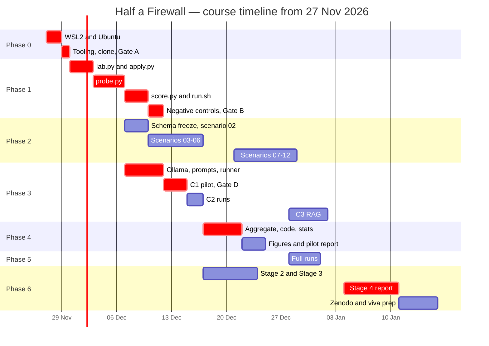

# Workflow Pipeline

**The whole project as tasks, in order, with honest time and difficulty.**

Re-baselined **27 November 2026** (Day 5 of the sprint — the original 23 Nov start
slipped; this document supersedes the calendar in `sprint-01.md`).

---

## How to read the estimates

Time is **focused work by one student**, not elapsed time. Difficulty is
**5 = research risk**, not 5 = tiring:

| Difficulty | Meaning | Typical sign you are at this level |
|---|---|---|
| **1 · Mechanical** | Known procedure, no decisions | install, clone, rename a file |
| **2 · Simple** | Known procedure, a little care | edit a YAML schema, write a table |
| **3 · Real work** | Design decisions, some debugging | a parser, a scorer, a scenario with a new topology |
| **4 · Open-ended** | You will debug something unplanned; likely to overrun | packet-level probing, model runner, retrieval |
| **5 · Research risk** | Outcome may be "does not work" rather than "takes longer" | *none in this project — by design* |

That last row matters. Everything here is engineering; the only genuine research
risk is whether the benchmark yields an interesting result, and that is a
question about the world, not about your schedule. This is why the project fits
a 30-mark course.

**Budget:** ~2–3 h/day, 6 days a week ≈ 15 h/week. Total ≈ **121 h attended**
plus ~6 h of unattended model runs.

---

## 1. The pipeline

```mermaid
flowchart TD

  subgraph P0["Phase 0 · Environment — 2.5 h"]
    A1["T0.1 Install WSL2 and Ubuntu"]
    A2["T0.2 Install nft, iproute2, python3"]
    A3["T0.3 Clone repo, run check-env --live"]
    A1 --> A2 --> A3
  end

  A3 --> GA{"Gate A · ping works on v4 AND v6"}
  GA -- no --> A1
  GA -- yes --> P1

  subgraph P1["Phase 1 · Harness — 20 h"]
    B1["T1.1 lab.py · build, reset, teardown"]
    B2["T1.2 apply.py · load ruleset, capture stderr"]
    B3["T1.3 probe.py · tcp, udp, icmp, ND"]
    B4["T1.4 score.py · verdicts, defect classes"]
    B5["T1.5 run.sh · expert gate must print PASS 11/11"]
    B6["T1.6 negative controls · defect C and defect D"]
    B1 --> B2 --> B3 --> B4 --> B5 --> B6
  end

  B6 --> GB{"Gate B · oracle flags known-bad configs"}
  GB -- no --> B3
  GB -- yes --> P2

  subgraph P2["Phase 2 · Benchmark — 26 h"]
    C1["T2.1 Freeze the YAML schema"]
    C2["T2.2 Scenario 02 · web server"]
    C3["T2.3 Scenarios 03-06"]
    C4["T2.4 Scenarios 07-12 · course minimum"]
    C5["T2.5 Second-coder check on 20 percent"]
    C1 --> C2 --> C3 --> C4 --> C5
  end

  C5 --> GC{"Gate C · 12 scenarios validated"}

  subgraph P3["Phase 3 · Generation — 25 h"]
    D1["T3.1 Ollama, pull one model"]
    D2["T3.2 Free-tier API key, smoke test"]
    D3["T3.3 Prompt templates C1, C2, C3"]
    D4["T3.4 run_models.py · call to JSON row"]
    D5["T3.5 C1 pilot · 6 scenarios x 3 models x 3 repeats"]
    D6["T3.6 C2 dual-stack runs"]
    D7["T3.7 C3 RAG corpus and retrieval log"]
    D1 --> D3
    D2 --> D3
    D3 --> D4 --> D5 --> D6 --> D7
  end

  GC -- yes --> D5
  D5 --> GD{"Gate D · pilot dataset exists"}

  subgraph P4["Phase 4 · Analysis — 20 h"]
    E1["T4.1 Aggregate JSON to CSV"]
    E2["T4.2 Defect coding A-E, manual audit"]
    E3["T4.3 Wilson CI, McNemar, kappa, Wilcoxon"]
    E4["T4.4 Figures"]
    E5["T4.5 Pilot report"]
    E1 --> E2 --> E3 --> E4 --> E5
  end

  GD -- yes --> E1
  E5 --> GE{"Gate E · numbers reproduce from a clean clone"}

  subgraph P5["Phase 5 · Full runs — 8 h attended"]
    F1["T5.1 Full C1 and C2 across the frozen suite"]
    F2["T5.2 Full C3, then re-run analysis"]
    F1 --> F2
  end

  GE -- yes --> F1

  subgraph P6["Phase 6 · Writing and release — 28 h"]
    G1["T6.1 Stage 2 lit review final"]
    G2["T6.2 Stage 3 implementation report"]
    G3["T6.3 Stage 4 final report"]
    G4["T6.4 Zenodo archive and DOI"]
    G5["T6.5 Viva preparation"]
    G1 --> G3
    F2 --> G3
    G2 --> G3 --> G4 --> G5
  end

  G5 --> GF{"Gate F · submission ready"}
```



---

## 2. Timeline

Assumes a Stage 4 deadline around mid-January. **If your date is earlier, cut
from the bottom of the ladder in §6 — do not compress the harness.**



---

## 3. Phase 0 — Environment

| ID | Task | Output | Time | Diff | Depends on | Failure mode |
|---|---|---|---|---|---|---|
| **T0.1** | `wsl --install -d Ubuntu`, reboot, create user | Working Ubuntu shell | 90 min + reboot | **1** | — | Needs admin rights; Windows update may stall |
| **T0.2** | `apt install nftables iproute2 python3` | `nft --version` works | 20 min | **1** | T0.1 | Corporate proxy blocks apt, unlikely here |
| **T0.3** | Clone repo, `sudo bash scripts/check-env.sh --live` | **Gate A** green | 20 min | **1** | T0.2 | Namespace creation needs root; IPv6 disabled in kernel |

**Why this block is first:** every later number is measured by sending packets.
If the lab cannot send a packet, nothing downstream exists.

---

## 4. Phase 1 — Harness

The contract for each module is already written in `harness/README.md`; this
phase implements it.

| ID | Task | Output | Time | Diff | Depends on | Failure mode |
|---|---|---|---|---|---|---|
| **T1.1** | `lab.py`: read `topology.yaml`, build three namespaces and two veth pairs, tear down completely, expose `reset()` | `python3 harness/lab.py up\|down\|reset` | 4 h | **3** | A | Interface names collide with a leftover run; teardown leaves a namespace behind |
| **T1.2** | `apply.py`: load a ruleset with `nft -f`, capture exit code and stderr verbatim, time it | Apply result in JSON | 2 h | **2** | T1.1 | Generated file may contain shell text; must not be `eval`ed |
| **T1.3** | `probe.py`: TCP connect, UDP datagram, ICMP echo, ICMPv6 ND — each **bound to the zone's source address**; classify `allow`/`drop`/`error` | Probe result list | 6 h | **4** | T1.1 | Binding source is the fiddly part; ND must be read from the neighbour cache, not from ping's exit code |
| **T1.4** | `score.py`: compare probes against `expected.yaml`, emit per-family and per-tier verdicts, classify A–E, emit the JSON row from the schema | `results/*.json` | 4 h | **3** | T1.3 | Classifier can mis-attribute E as C; needs the `resolution` field |
| **T1.5** | `run.sh`: orchestrate reset → apply → probe → score for one scenario | One command that prints the verdict | 2 h | **2** | T1.4 | Exit codes must separate `1 = model failed` from `2 = harness failed` |
| **T1.6** | `tests/negative/`: hand-write one defect-C config and one defect-D config; prove the harness flags both, and that the expert still passes 11/11 | **Gate B** | 2 h | **3** | T1.5 | If the broken configs pass, the oracle is measuring nothing |

**Phase total: 20 h.** This is the hardest engineering block and the one most
likely to overrun. Reserve the weekend for it.

---

## 5. Phase 2 — Benchmark authoring

| ID | Task | Output | Time | Diff | Depends on | Note |
|---|---|---|---|---|---|---|
| **T2.1** | Freeze the YAML schema; write it into `bench/scenarios/README.md` as final | Schema v1 | 1 h | **1** | T1.5 | Before this point, changing the schema is free. After, it costs a re-run |
| **T2.2** | Scenario 02 — web server, scoped source, `policy drop` | 3 files + passing expert | 3 h | **3** | T2.1 | Second one is always slower than expected; topology reuse starts here |
| **T2.3** | Scenarios 03–06 — DB, DNS, container host, gateway | 12 files + 4 passing experts | 10 h | **3** | T2.2 | ~2.5 h each once the pattern holds |
| **T2.4** | Scenarios 07–12 — remaining families and variants to reach the course minimum | 18 files + 6 passing experts | 12 h | **2** | T2.3 | Drops to difficulty 2 because you are recombining, not designing |
| **T2.5** | Second-coder check on 20% of oracles (blind: they read the prompt, write the expected outcomes, you diff) | Agreement note in `docs/` | 4 h | **3** | T2.4 | Needs another person; if unavailable, record it as an unmitigated threat instead of pretending |
| **T2.6** | *(post-course)* Freeze at 32 scenarios | Full suite | 40 h | **3** | T2.4 | Tedious, not hard. Only if the paper route continues |

**Phase total to course minimum: 30 h.** Deliberately ordered so that the
benchmark is usable at 6 scenarios and good at 12 — you are never blocked on
finishing 32.

---

## 6. Phase 3 — Generation

| ID | Task | Output | Time | Diff | Depends on | Note |
|---|---|---|---|---|---|---|
| **T3.1** | Install Ollama, pull one 7–8B instruct model, record exact tag and quantisation | `generate/models.yaml` entry | 60 min | **1** | — | Disk heavy; check free space first |
| **T3.2** | Obtain a free-tier API key, make one successful call | Second model entry | 30 min | **1** | — | If unavailable, the plan survives with two local models; say so in the report |
| **T3.3** | Write C1, C2, C3 prompt templates; hash them | `generate/prompts/` | 2 h | **2** | T2.1 | Templates are frozen after the first recorded run |
| **T3.4** | `run_models.py`: call → extract first fenced block → apply → probe → score → one JSON row; log prompt hash and raw output | The runner | 6 h | **4** | T1.5, T3.3 | Extraction edge cases (no fence, prose, multiple blocks) are where this overruns |
| **T3.5** | C1 pilot: 6 scenarios × 3 models × 3 repeats | ~54 rows | 2 h attended + unattended | **2** | T3.4 | **Gate D** |
| **T3.6** | C2 dual-stack runs, same grid | ~54 rows | 1 h attended | **2** | T3.5 | Cheapest, most informative comparison in the project |
| **T3.7** | C3 RAG: build the corpus (nftables wiki, `man nft`, RFC 9099), retrieve per scenario, log passages | Retrieval log + rows | 8 h | **4** | T3.6 | Chunking choice is a design decision; log it, do not tune it |
| **T3.8** | *(cuttable)* C4 repair loop: show failing probes, retry ≤2 rounds | Repair rows | 5 h | **4** | T3.7 | Highest effort per unit of result |

**Phase total: 25 h.** Half of it is unattended; treat the attended hours as the
real cost.

---

## 7. Phase 4 — Analysis

| ID | Task | Output | Time | Diff | Depends on | Note |
|---|---|---|---|---|---|---|
| **T4.1** | Aggregate raw JSON into one CSV, one row per cell | `results/pilot-summary.csv` | 3 h | **2** | T3.5 | Must be regenerable from `results/*.json` alone |
| **T4.2** | Code every failure into A–E; manually audit a random 20% against the raw configuration | Coded table + agreement rate | 4 h | **3** | T4.1 | The classifier is a claim; the audit is the evidence |
| **T4.3** | Wilson CIs, McNemar for C1 vs C3, Cohen's κ for static vs execution, Wilcoxon for exposure delta | Numbers for the report | 6 h | **3** | T4.2 | Report intervals, not bare percentages |
| **T4.4** | Two figures: v4 vs v6 pass rate per model; defect-class distribution | PNGs in `results/figures/` | 3 h | **2** | T4.3 | Small, readable, one message each |
| **T4.5** | Pilot report: what happened, what it means, what it does not | `docs/pilot-report.md` | 4 h | **3** | T4.4 | **Gate E** |

**Phase total: 20 h.** This is the phase students underestimate most. Budget it
before the writing phase, not during it.

---

## 8. Phases 5 and 6 — Full runs, writing, release

| ID | Task | Output | Time | Diff | Depends on |
|---|---|---|---|---|---|
| **T5.1** | Full C1 + C2 across the frozen suite | Full dataset | 2 h attended | **2** | E |
| **T5.2** | Full C3, then re-run analysis unchanged | Final numbers | 6 h attended | **2** | T5.1 |
| **T6.1** | Stage 2 — literature review, final | Rubric stage (6 marks) | 6 h | **2** | T4.5 |
| **T6.2** | Stage 3 — implementation report | Rubric stage (9 marks) | 8 h | **3** | T4.5 |
| **T6.3** | Stage 4 — final report | Rubric stage (10 marks) | 12 h | **4** | T5.2, T6.1, T6.2 |
| **T6.4** | Zenodo archive + DOI, update `CITATION.cff` | Citable artifact | 1 h | **1** | T6.3 |
| **T6.5** | Viva preparation: the gap sentence, the three controls, ten likely questions | Notes | 4 h | **3** | T6.3 |

**Phase total: 39 h**, of which 10 h is rubric stages 2 and 3 that overlap with
work you have already done — write them from the repo, not from memory.

---

## 9. Critical path

```
Gate A → T1.1 → T1.3 → T1.4 → T1.5 → Gate B
                     ↓
        T3.4 → T3.5 → Gate D → T4.1 → T4.3 → T4.5 → Gate E
                     ↓
                T6.3 → T6.4 → T6.5 → Gate F
```

Two difficulty-4 tasks sit on it — **T1.3 `probe.py`** and **T3.4
`run_models.py`**. Everything else can slip a day without moving the deadline.
Those two cannot. Schedule them for days when you have three uninterrupted
hours, not the end of a tired evening.

---

## 10. Gates, restated as pass conditions

| Gate | Name | Passes only when | If it fails |
|---|---|---|---|
| **A** | Lab works | `check-env.sh --live` pings `10.20.0.1` and `2001:db8:20::1` from `cli_admin` | Stop. Nothing is measurable. |
| **B** | Oracle can fail | Expert passes 11/11 **and** both negative controls are flagged | The oracle is untested; fix before authoring more scenarios |
| **C** | Benchmark validated | 12 scenarios, each expert at 100%, schema frozen | Ship 6; say so in the report |
| **D** | Pilot data exists | ≥6 scenarios × 3 models × C1 × 3 repeats as JSON | Cut to 4 scenarios; keep 3 models and 3 repeats |
| **E** | Analysis reproduces | A clean clone regenerates the summary CSV and both figures with two commands | Numbers are not yet a result |
| **F** | Submission ready | Stages 1–4 written, artifact DOI minted, viva notes ready | — |

---

## 11. Cut ladder — apply top to bottom

| Cut | Saves | Costs |
|---|---|---|
| 1. C4 repair loop (T3.8) | 5 h | Loses one intervention; RQ3 still answered by C1 vs C3 |
| 2. Scenarios 12 → 6 (T2.4, T2.5) | 16 h | Wider CIs; still a valid pilot |
| 3. C3 RAG (T3.7) | 8 h | Loses RQ3's second half; RQ1 and RQ2 intact |
| 4. Third model (T3.2) | 1 h | Weakens the model comparison, not the finding |
| 5. Full runs (Phase 5) | 8 h | Report becomes a pilot study — acceptable at course level |
| **Never** | Expert gate, negative controls, IPv6-disabled control, 3 repeats | Without these there is no result, only output |

---

## 12. Where you are, 28 November

| Item | State |
|---|---|
| Repo published with full plan, scenario 01 and 02 | **done** |
| Gate A — lab works | **passed 28 Nov** · Ubuntu 26.04.1 on WSL2 (kernel 6.18.58.1), both pings across a veth pair |
| Gate B — oracle can fail | **passed 28 Nov** · expert 37/37 (01) and 21/21 (02); negatives exit 1 with `[C,E]`, `[D]`, `[D]` |
| Phase 1 harness code | **executed** (T1.1–T1.6); three harness bugs found and fixed, listed in the commit log |
| Hours spent on the pipeline above | ~6 of 121 |

The two gates that the plan called non-negotiable are both green, and the second
one earned its keep: running it found that the harness had never actually built
the lab, that the peers had no route through the DUT, and that a harness
failure exited 1 — the same code as "a probe disagreed". None of those would
have been visible from a code review.

The honest schedule position: ~6 of 121 hours, with the environment work
(costing more than the 2.5 h estimate, mostly install retries) finished. Phase 1
is 12 h of remaining work, of which the model runner is the next item.

**Next action:** `generate/run_models.py` and scenarios 03–06, then a pilot
dataset of six scenarios × three models × three repeats.
